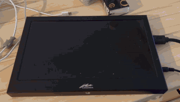
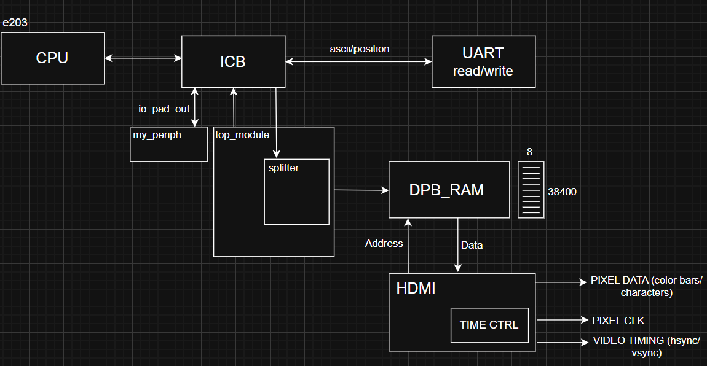

# HDMI Text Terminal for a RISC-V SoC

A memory-mapped HDMI text-terminal peripheral for the Hummingbird E203 RISC-V core, implemented on a Sipeed Tang Primer 20K board (Gowin GW2A-18C FPGA). Characters typed on a PC arrive over UART, are read by the firmware running on the RISC-V core and are shown on an HDMI monitor as an 80 × 45 monochrome terminal at 1280 × 720 @ 60 Hz, after a 5-second colour-bar test pattern.

Team project for *Intelligent Chip Design*, Tongji University, Shanghai, 2025/26, by Camilla Malossi, Emma Teodorani and Ginevra Boltim.

Full project report: [docs/report_hdmi_character_display.pdf](docs/report_hdmi_character_display.pdf)

<p align="center">
  <a href="docs/media/hdmi_terminal_demo.mp4"></a>
</p>

<p align="center">Power-up on the Tang Primer 20K: the eight colour bars, then the text terminal with the boot banner.<br><a href="docs/media/hdmi_terminal_demo.mp4">Watch the full video (20 s)</a></p>

## Highlights

- Custom peripheral on the E203 ICB bus with four memory-mapped registers
- Dual-clock text buffer: the CPU writes characters at ~17 MHz, the video pipeline reads them at 74.25 MHz
- 1280 × 720 @ 60 Hz video timing with on-the-fly glyph rendering from a font ROM
- Terminal behaviour in hardware: auto-advance, line wrap, newline, backspace
- Self-checking testbenches for every module (92 checks) and a full-SoC testbench that boots the real firmware
- Synthesised and brought up on the board, including four synthesis and place-and-route issues diagnosed and fixed

## Architecture



```
UART0 RX -> firmware (main.c) -> ICB write -> HDMI_icb_bus -> HDMI_top -> HDMI_driver -> DVI_TX -> TMDS -> HDMI
                                              0x1001_4000     text buffer   timing and     (Gowin IP)
                                                              (dual clock)  font ROM
```

The starting point was the course's reference SoC: the bare E203 core with its standard peripherals. The HDMI peripheral is attached to the E203 peripheral bus in the address slot originally used by QSPI0 (`0x1001_4000` to `0x1001_4FFF`).

### Design choices

**Store characters, not pixels.** A 640 × 480 one-bit framebuffer already needs 38.4 KB, most of the available block RAM. The design instead stores the ASCII code of each character cell (80 × 45 = 3,600 cells) and renders each glyph from a constant font ROM while the screen is scanned. Memory now depends on the number of characters rather than the number of pixels, which made it possible to target 1280 × 720 instead of the required minimum of 640 × 480.

**Split the clock domains at the text buffer.** The E203 core and its bus run on the ~17 MHz system clock, while 1280 × 720 @ 60 Hz needs a 74.25 MHz pixel clock. A dual-port block RAM separates the two: the CPU domain owns the write port and the video domain owns the read port, so pixel data never crosses clock domains.

### Register map

| Offset | Access | Meaning |
|---|---|---|
| `0x00` | read | text grid size: `[15:8]` rows (45), `[7:0]` columns (80) |
| `0x04` | write | ASCII character to place at the cursor |
| `0x08` | write | cursor position: `[13:8]` row, `[6:0]` column |
| `0x0C` | write | commands: bit 0 clear, bit 1 newline, bit 2 carriage return, bit 3 backspace |

`HDMI_top` turns register writes into terminal behaviour: printable characters advance the cursor and wrap at the end of each row (and from the last row back to the first), backspace also moves back across line boundaries, and the cursor register lets software place text anywhere on the grid.

### Video path

`HDMI_driver` generates 1280 × 720 @ 60 Hz timing (1650 × 750 total pixels per frame, 74.25 MHz pixel clock). For the first 371,250,000 pixel-clock cycles, exactly 5.000 s, it shows eight vertical colour bars, then it switches permanently to the text display. The pixel clock comes from a Gowin rPLL (27 MHz × 55 / 4 = 371.25 MHz) followed by a divide-by-5, and the Gowin DVI_TX IP serialises the RGB signal into TMDS.

## Verification

Each part of the design has its own self-checking Icarus Verilog testbench that prints `[PASS]`/`[FAIL]` for every check.

| Testbench | Unit under test | What it checks | Checks |
|---|---|---|---|
| TB1 `tb_icb_register` | `HDMI_icb_bus` | register reads and writes, unmapped addresses | 8 |
| TB2 `tb_colorbars_timer` | `HDMI_driver` | colour of each bar, blanking, switch to text after exactly 5 s | 15 |
| TB3 `tb_font_rom` | font ROM | glyph rows for sample characters, blank output outside the printable range | 51 |
| TB4 `tb_cursor_terminal` | `HDMI_top` | line wrap, backspace across lines, newline, cursor clamping, clear | 12 |
| TB5 `tb_video_timing` | `HDMI_driver` | sync widths, line and frame period, 60.000 Hz refresh | 6 |
| TB6 `tb_uart_e2e` | full SoC + firmware | UART byte → firmware → peripheral → cursor, end to end | 8 |

TB6 boots the complete SoC with the compiled firmware (`ram.hex`) and sends real 115200-baud UART frames to it, so it simulates every RISC-V instruction executed during boot.

**Current status.** TB1 to TB5 pass (92 checks). TB6 does not pass yet. Investigating the failure reported at submission showed two separate problems:

1. The original testbench started typing after 30 ms of simulated time, but the firmware only finishes its boot banner at about 47 ms, because after clearing the screen it runs a 100,000-iteration wait loop. The "H" it detected was the first letter of the banner "HDMI terminal ready", not the byte it had sent, so every later check was out of step. The testbench in this repository now waits for the "> " prompt before typing and gives the firmware 50 µs to process each byte.
2. With the timing fixed, the boot sequence and the full banner are verified in simulation, but the bytes driven onto the UART0 RX pin are not received by the firmware. The terminal works on the board with a USB-UART adapter, so the cause is in the simulation set-up (UART and GPIO path model or stimulus) and is still under investigation.

The TB6 section of the report describes the analysis made at the time of submission.

## FPGA implementation

Place-and-route results on the GW2A-18C:

| Resource | Used |
|---|---|
| Logic (LUT, ALU) | 11,466 / 20,736 (56 %) |
| Registers | 4,591 / 16,173 (29 %) |
| Block RAM | 61 % |
| PLL | 3 / 4 |

Bring-up on the board required fixing four issues that did not show up in simulation, all documented in the report:

1. an unused legacy module with mixed edge- and level-sensitive logic blocked synthesis and was removed from the build;
2. the top module (`board_hdmi_top`) was not set in the Gowin project;
3. two PLLs in the E203 clock unit were configured for a different device (GW2A-55 instead of GW2A-18);
4. the RISC-V debug JTAG signals use the FPGA's dedicated JTAG pins, which required enabling "Use JTAG as regular IO".

## Known limitations

- The place-and-route timing report shows the 74.25 MHz pixel-clock domain does not meet its constraint (27 failing endpoints, estimated Fmax about 54 MHz). The design worked on the board, but timing closure of the font-rendering path is an open item.
- The cursor-position register works but the firmware only uses it once at boot; the host cannot yet move the cursor freely.
- The text buffer provides 19,200 cells while 3,600 are used; a smaller RAM would free block RAM for per-character colour attributes.

## Repository structure

```
rtl/core/          Hummingbird E203 core and SoC (Apache 2.0), modified to integrate the peripheral
rtl/ip/my_ip/      HDMI peripheral: ICB register block, text buffer, video timing and font ROM,
                   board top level, Gowin PLL, block RAM and DVI_TX IP
firmware/          UART-to-HDMI firmware (main.c) and board support package; Debug/ram.hex is the
                   compiled image loaded into the core's instruction memory at synthesis
sim/tb/            the six testbenches and run_all.sh
gowin_prj/         Gowin project, pin and timing constraints, process settings
tools/makehex64/   binary-to-hex converter used by the firmware build
docs/              project report, block diagram and hardware demo video
```

## Running

**Simulation** (Icarus Verilog). TB4 and TB6 also need Gowin's simulation library, see [sim/gowin_sim_lib/README.md](sim/gowin_sim_lib/README.md).

```sh
cd sim/tb
./run_all.sh                 # all six testbenches
./run_all.sh tb2 tb5         # selected testbenches
IVERILOG_DEFS="-DNO_VCD" ./run_all.sh tb6   # TB6 without waveform dump (faster)
```

**Firmware** (RISC-V GCC toolchain with the `riscv-none-elf-` prefix):

```sh
cd firmware/hello_world/Debug
make
```

The build regenerates `ram.hex`, which is read at synthesis time, so the FPGA project must be resynthesised after a firmware change.

**FPGA** (Gowin IDE): open `gowin_prj/e203_basic_chip.gprj`. The project uses relative paths, sets `board_hdmi_top` as top module and enables "Use JTAG as regular IO"; the pin (`.cst`) and timing (`.sdc`) constraints are included.

## Third-party code

- **Hummingbird E203** RISC-V core and SoC by Nuclei System Technology, Apache License 2.0 (see `rtl/core/LICENSE`). Modified files: `e203_soc_demo.v`, `e203_soc_top.v`, `e203_subsys_top.v`, `e203_subsys_main.v`, `e203_subsys_perips.v` (peripheral integration and HDMI ports), `e203_itcm_ram.v` (firmware image loading) and `e203_clk_unit.v` (PLL device setting).
- **Gowin IP** generated with the Gowin IP Core Generator: rPLL, dual-port block RAM and DVI_TX.

## Acknowledgements

Thanks to our course-mates Laerte Riccardo Ucci and Vito Costantino, whose working implementation we used as a reference for cross-checking, and with whom we discussed the hardest problems.
